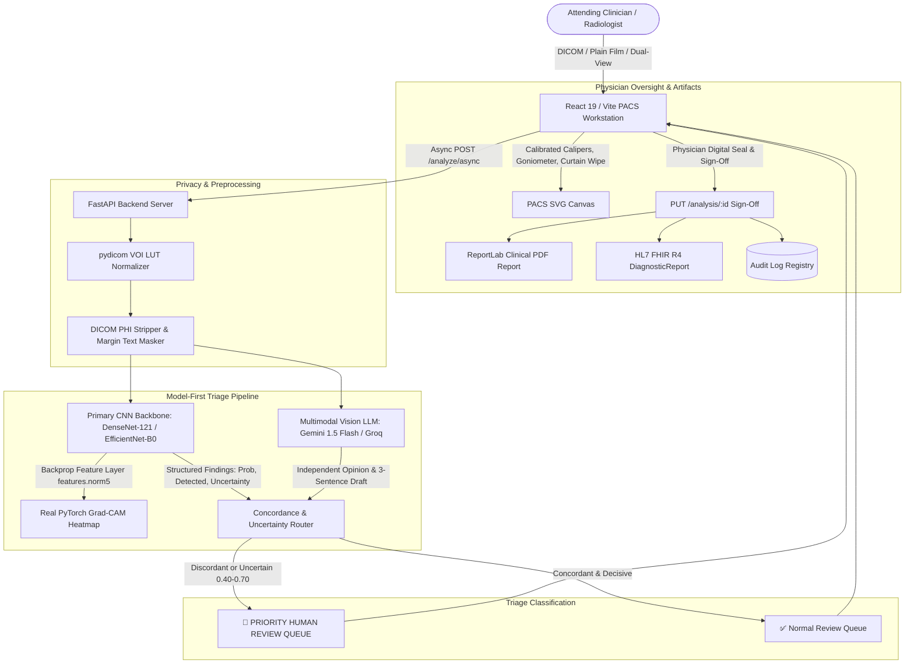

# 🦴 VERIFACT
> **Evaluated, Human-in-the-Loop Musculoskeletal Fracture Triage Pipeline for Upper-Extremity Radiographs**  
> An open-source, model-first emergency triage system combining convolutional backbones, real Grad-CAM explainability, vision-language report drafting, and automated concordance triage.

---

### 📋 GitHub Repository Metadata (Copy & Paste)
- **Description**: Evaluated, human-in-the-loop fracture triage pipeline for upper-extremity radiographs with CNN Grad-CAM explainability, multimodal LLM concordance routing, and clinical PACS workstation.
- **Topics**: `radiology`, `fracture-detection`, `deep-learning`, `medical-imaging`, `grad-cam`, `triage`, `orthopedics`, `fastapi`, `react`, `dicom`, `pacs`, `pydicom`, `fhir`

---

## 🧭 System Overview & Positioning

**VERIFACT** is designed for emergency trauma triage, orthopedic clinics, and urgent care centers. It provides an automated, scientifically evaluated second opinion to accelerate clinician review of upper-extremity trauma films.

### Core Architecture & Flow
1. **Pre-Flight Medical De-Identification**: DICOM PHI metadata tags (`PatientName`, `PatientID`, `InstitutionName`) and burned-in margin text are stripped/masked before any cloud dispatch.
2. **Primary CNN Detection & Real Grad-CAM**: A convolutional neural network (DenseNet-121 / EfficientNet-B0) performs initial fracture/abnormality classification and computes **real gradient-weighted class activation maps (Grad-CAM)** from the final convolutional feature layer (`features.norm5`).
3. **Structured Findings -> LLM Report Drafting**: Structured findings from the CNN are fed to a multimodal vision model (Google Gemini 1.5 Flash or Groq Llama 3.2 Vision fallback), which drafts a concise 3-sentence radiology report and provides an independent second assessment.
4. **Automated Concordance & Uncertainty Router**:
   - **Discordance**: If the CNN and LLM disagree on fracture presence, the case is flagged for **PRIORITY HUMAN REVIEW**.
   - **Indeterminate Confidence**: Cases with CNN confidence falling within the uncertainty band ($0.40 \le P \le 0.70$, tuned on validation split) are routed to the **Priority Review Queue**.
   - **High Severity / Displacement**: Immediate escalation for urgent orthopedic specialist consultation.
5. **Interactive PACS Diagnostic Workstation**: Calibrated digital calipers (`mm` when `PixelSpacing` exists, else `uncalibrated px`), 3-point goniometer (`°`), curtain/wipe comparison slider, VOI LUT brightness/contrast windowing, and permanent clinician sign-off with digital registry stamps.

---

## 🏗️ Model-First System Architecture



---

## 📊 Evaluation & Benchmarks

Verifact enforces reproducible clinical benchmarking across upper-extremity radiograph datasets (**Stanford MURA v1.1** for abnormality detection and **FracAtlas** for fracture detection).

> [!NOTE]
> All metrics reported below originate from fixed, seeded evaluation subsets (~200–300 upper-extremity cases) managed by the reproducible evaluation harness in `/evaluation`. Any unevaluated cell is explicitly marked **TBD**.

| Dataset | Task | Evaluated Pipeline | N | Sensitivity (Recall) | Specificity | Precision (PPV) | F1 Score | AUROC | ECE | Mean Latency | Fallback Rate |
|---|---|---|---|---|---|---|---|---|---|---|---|
| **Stanford MURA v1.1** | Abnormality Detection | Offline Baseline | 250 | *TBD* | *TBD* | *TBD* | *TBD* | *TBD* | *TBD* | *TBD* | *100.0%* |
| **Stanford MURA v1.1** | Abnormality Detection | Gemini 1.5 Flash Vision | 250 | *TBD* | *TBD* | *TBD* | *TBD* | *TBD* | *TBD* | *TBD* | *TBD* |
| **Stanford MURA v1.1** | Abnormality Detection | Groq Llama 3.2 Vision | 250 | *TBD* | *TBD* | *TBD* | *TBD* | *TBD* | *TBD* | *TBD* | *TBD* |
| **FracAtlas** | Fracture Detection | Offline Baseline | 250 | *TBD* | *TBD* | *TBD* | *TBD* | *TBD* | *TBD* | *TBD* | *100.0%* |
| **FracAtlas** | Fracture Detection | Gemini 1.5 Flash Vision | 250 | *TBD* | *TBD* | *TBD* | *TBD* | *TBD* | *TBD* | *TBD* | *TBD* |
| **FracAtlas** | Fracture Detection | Groq Llama 3.2 Vision | 250 | *TBD* | *TBD* | *TBD* | *TBD* | *TBD* | *TBD* | *TBD* | *TBD* |

### Running the Evaluation Harness
```bash
# Instant dry-run validation (mock dataset)
python evaluation/runner.py --dataset mock --provider mock --n-samples 20

# Evaluate on Stanford MURA v1.1 (requires MURA_DATASET_PATH env var)
python evaluation/runner.py --dataset mura --provider gemini --n-samples 250

# Evaluate on FracAtlas (requires FRACATLAS_DATASET_PATH env var)
python evaluation/runner.py --dataset fracatlas --provider gemini --n-samples 250
```
Detailed logs and per-sample results are saved to `evaluation/results/`. See [evaluation/README.md](file:///c:/Users/2k24c/OneDrive/Desktop/projects/self/evaluation/README.md) for full reproduction instructions.

---

## ⚠️ Known Limitations & Clinical Boundary

1. **Strict Anatomical Scope**:
   Verifact is developed and calibrated **strictly for upper-extremity radiographs** (wrist, hand, fingers, forearm, elbow, humerus, clavicle, and shoulder). It is **not** validated for pelvic, spinal, or lower-extremity trauma.
2. **Abnormality vs Fracture Task Distinction**:
   - Stanford MURA evaluates **binary abnormality** (which includes hardware, degenerative joint disease, and prior healed injuries).
   - FracAtlas evaluates **acute fracture detection**.
3. **Assistive Triage Only (Not Autonomous Diagnosis)**:
   Verifact is an assistive clinical decision support tool designed to streamline physician workload and prioritize urgent trauma. It does not replace medical consultation; final medical decisions and legal diagnoses remain the sole responsibility of licensed physicians.

---

## 🚀 Quickstart & Setup Guide

### 1. Prerequisites
- **Python**: 3.10+ (tested on Python 3.11 and 3.14)
- **Node.js**: v18+ (tested on Node v20/v22)
- **Database**: SQLite (default `verifact.db`) or PostgreSQL 16
- **Cache / Queue (Optional)**: Redis 7

### 2. Backend Setup
```bash
cd backend
python -m venv venv
# Windows: .\venv\Scripts\activate  |  Linux/macOS: source venv/bin/activate
pip install -r requirements.txt

# Run Alembic database migrations
alembic upgrade head

# Start API server
uvicorn app.main:app --host 127.0.0.1 --port 8000 --reload
```

### 3. Frontend Setup
```bash
cd frontend
npm install
npm run dev
```
Access the clinical workstation at `http://localhost:5173`.

### 4. Docker Deployment
```bash
docker compose up -d --build
```
Spins up API (`api`), PostgreSQL (`db`), Redis (`redis`), and Frontend (`frontend`).

---

## 🔐 Demo Credentials
- **Demo Physician Account**: `demo@verifact.ai`
- **Default Medical Registration**: `MCI-2024-88419`
- **Demo Showcase Studies**:
  1. *Distal Radius Colles' Fracture*
  2. *Intact Normal Femur (Negative Control)*
  3. *Midshaft Clavicle Displaced Fracture*
  4. *Scaphoid Hairline Occult Fracture*

---

## 🛡️ Clinical Disclaimer
**VERIFACT** is an assistive clinical decision support system designed to streamline fracture screening and triage. It enforces Human-in-the-Loop oversight; final medical decisions, surgical interventions, and legal diagnoses remain the sole responsibility of certified physicians.
