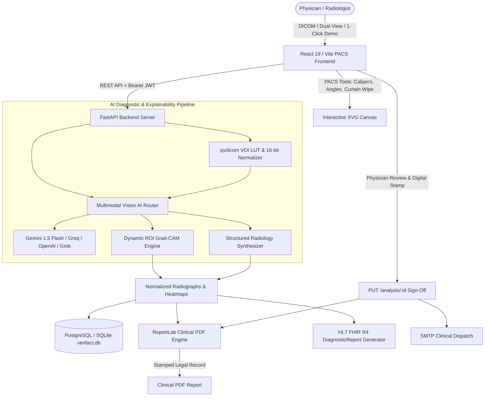

# 🦴 VERIFACT: Clinical AI Co-Pilot & PACS Workstation
> **Verifact AI Clinical Orthopedic Expert System**  
> Enterprise-grade, AI-assisted clinical co-pilot designed for emergency trauma triage, orthopedic clinics, and radiology departments.

---

## 🧭 Executive Summary & Core Concept

**VERIFACT** ingests plain musculoskeletal radiographs (X-rays) and native medical DICOM (`.dcm`, `.dicom`) studies, analyzes single-view or orthogonal dual-view (AP + Lateral) trauma series through an advanced multimodal vision AI pipeline, localizes cortical disruptions via dynamic Grad-CAM heatmaps, provides PACS digital caliper & angle measurement tools, synthesizes structured radiology findings, and generates HL7 FHIR R4 resources and signed clinical PDF reports.

### Key Capabilities
- **Multimodal Vision AI**: Powered by Google Gemini 1.5 Flash Vision, Groq Vision (`llama-3.2-11b-vision-preview`), OpenAI (`gpt-4o-mini`), and xAI Grok with intelligent multi-provider fallback.
- **Dynamic Grad-CAM Visual Explainability**: Model-localized ROI coordinate activation heatmaps overlaid onto radiographs at a calibrated 40% alpha blend.
- **Medical DICOM Parser**: Reads 12-bit/16-bit pixel arrays, VOI LUT (Window Center / Width), `MONOCHROME1` inversion, and DICOM study tags (`BodyPartExamined`, `ViewPosition`, `PatientID`).
- **Orthogonal Dual-View Triage**: Bi-planar AP and Lateral view ingestion with synchronized side-by-side or stacked PACS viewing.
- **Clinical PACS Measurement Suite**:
  - Digital Caliper / Ruler (`mm`)
  - 3-Point Goniometer / Angle Tool (`°` for Cobb angles, dorsal tilt, radial inclination)
  - Clinical Pointer Arrow
  - Window/Level Brightness & Contrast sliders
  - 1-Click Negative Film Inversion
  - Smooth Zoom & Drag Pan Loupe
  - Curtain / Wipe Split-Screen Comparison Slider (Raw Film vs. Heatmap)
- **FHIR R4 & Email Interoperability**:
  - 1-Click HL7 FHIR R4 `DiagnosticReport` JSON generation
  - Secure SMTP dispatch delivering stamped clinical PDF reports to attending specialists
- **Human-in-the-Loop Oversight**: Clinician edits findings, enters clinical notes, and digitally signs off with permanent MCI/NMC stamps.
- **Clinical PDF Generator**: ReportLab streaming export with color-coded severity, findings table, caliper measurements, and physician digital seal.

---

## 🏗️ High-Level System Architecture



---

## 🚀 Quickstart Guide

### 1. Prerequisites
- **Python**: 3.10+ (tested on Python 3.14)
- **Node.js**: v18+ (tested on Node v22/v24)
- **npm**: 9+

### 2. Backend Setup
```bash
cd backend
python -m venv vemv
# Windows:
.\vemv\Scripts\activate
# Linux/macOS:
# source vemv/bin/activate

pip install -r requirements.txt
cp .env.example .env
# Fill in GEMINI_API_KEY, GROQ_API_KEY, or other preferred vision keys

python -m uvicorn app.main:app --host 127.0.0.1 --port 8000 --reload
```

### 3. Frontend Setup
```bash
cd frontend
npm install
npm run dev
```

Visit `http://localhost:5173` to access the Verifact workstation.

---

## 🔐 Credentials & Demo Showcase
- **Demo Physician Account**: `demo@fractoes.ai` (or register any doctor email with instant verification)
- **Default Medical Registration**: `MCI-2024-88419`
- **1-Click Clinical Demos**:
  1. *Distal Radius Colles' Fracture*
  2. *Intact Normal Femur (Negative Control)*
  3. *Midshaft Clavicle Displaced Fracture*
  4. *Scaphoid Hairline Occult Fracture*

---

## 🛡️ Clinical Disclaimer
**VERIFACT** is an assistive clinical decision support tool designed to streamline fracture screening and triage. It enforces Human-in-the-Loop oversight; final medical decisions, surgical interventions, and legal diagnoses remain the sole responsibility of certified physicians.
